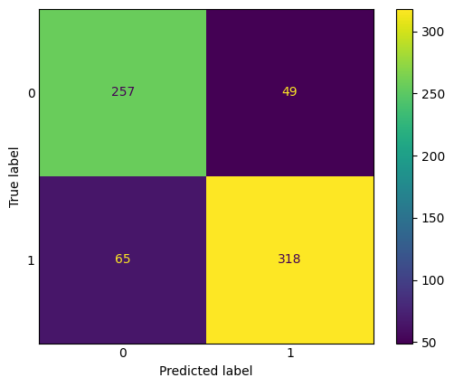
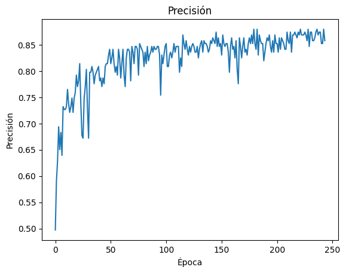
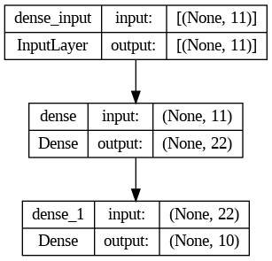

# Neural Networks vs Naive Bayes

**Heart failure and wine quality classification**

   

## Overview

Two classification problems solved with a **Keras neural network** and compared with **Naive Bayes** models.
The networks use He-uniform initialisation, Adam, `EarlyStopping` and `ReduceLROnPlateau`, and their training
is monitored with `livelossplot`.

| Notebook | Dataset | Naive Bayes | Neural network |
| --- | --- | --- | --- |
| [Heart](https://colab.research.google.com/github/Steven-Macas/redes-neuronales-SAA/blob/main/SSA_stevenMacas_red_neuronal_heart.ipynb) | [Heart Failure Prediction](https://www.kaggle.com/datasets/fedesoriano/heart-failure-prediction) | **83.5 %** (Gaussian) | 81.8 % |
| [Wine](https://colab.research.google.com/github/Steven-Macas/redes-neuronales-SAA/blob/main/SSA_stevenMacas_red_neuronal_wine.ipynb) | [Wine Quality](https://www.kaggle.com/datasets/yasserh/wine-quality-dataset) | 50.9 % (Gaussian) · 32.9 % (Multinomial) | **55.5 %** |

Accuracy on the test set. On the heart data the simpler Gaussian Naive Bayes model beats the neural network,
as the notebook's conclusion points out; on the wine data the network wins.

## Results

<table>
  <tr><td align="center" valign="top"> Heart – Gaussian Naive Bayes confusion matrix</td><td align="center" valign="top"> Heart – neural network accuracy per epoch</td><td align="center" valign="top"> Heart – network architecture</td></tr>
</table>

*The notebooks are written in Spanish.*

---

Made by <b>Steven Macas</b> — Data Engineer &amp; Data Analyst · <a href="https://gointy.com">gointy.com</a> · <a href="https://www.linkedin.com/in/steven-macas">LinkedIn</a> · <a href="https://github.com/Steven-Macas">GitHub</a>
